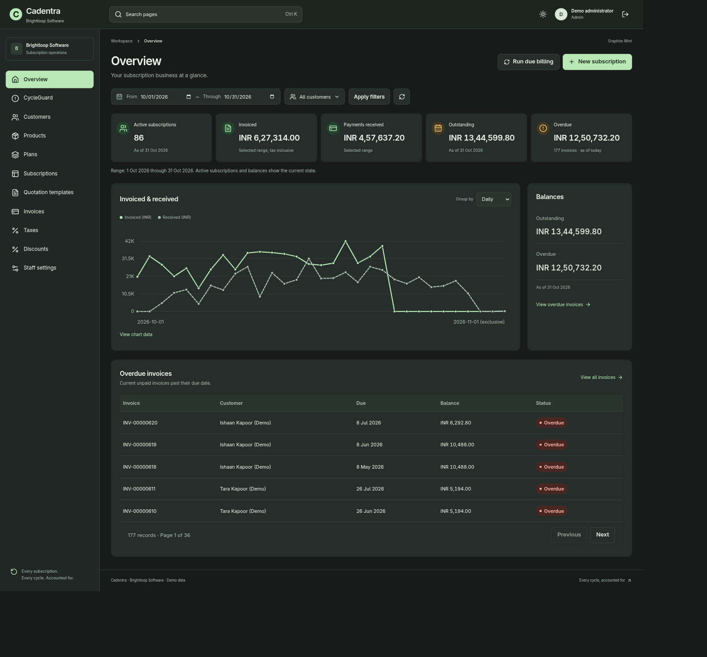
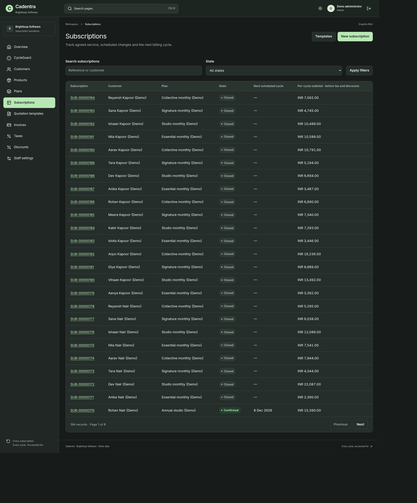
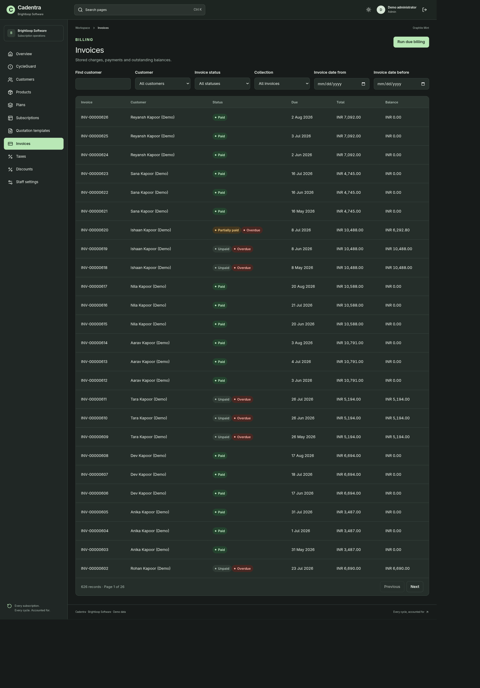
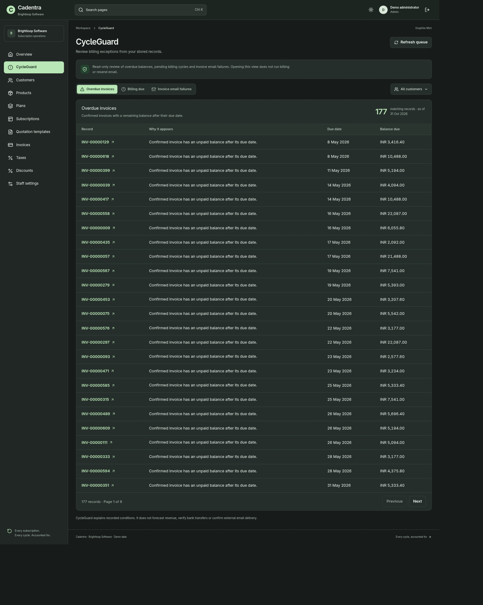
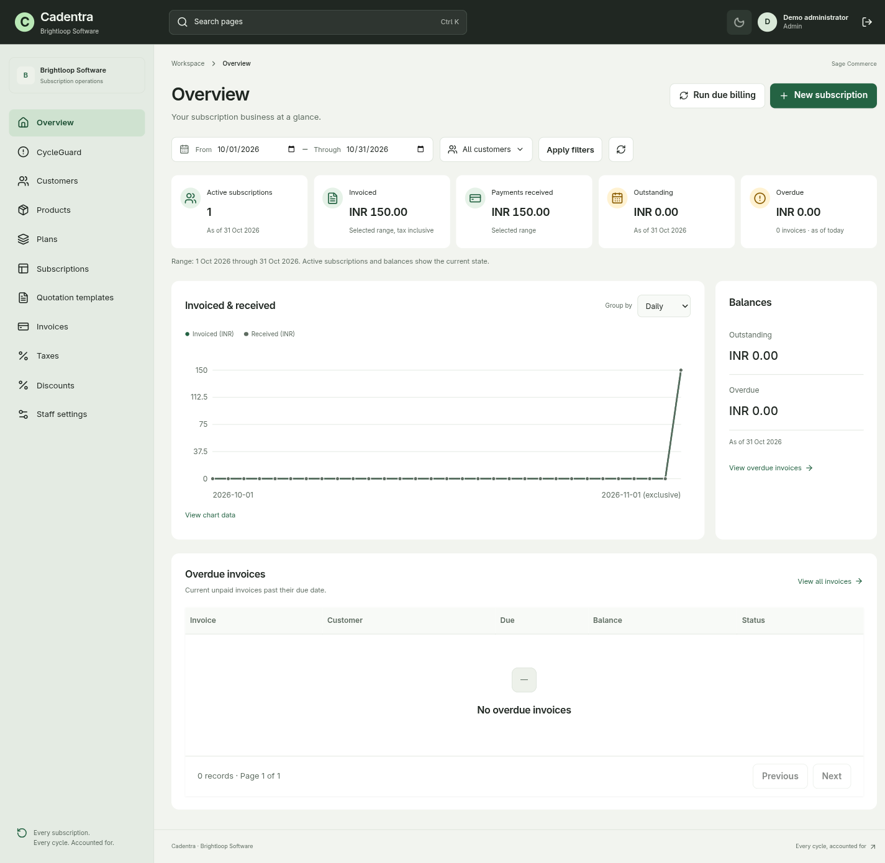
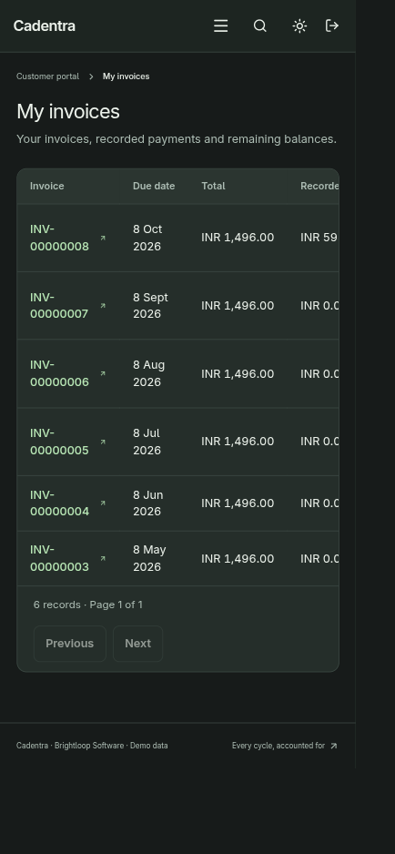
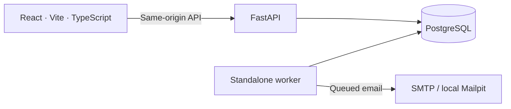

<div align="center">

# Cadentra

### Every subscription. Every cycle. Accounted for.

From the first quotation to the final payment.<br>
A subscription workspace for the people running the business and the customers behind every invoice.

**[▶ Watch the demo](https://drive.google.com/file/d/1v_cj3df0G4bhmBy8DPQwsJKwAmHxwXqM/view?usp=sharing)** &nbsp; · &nbsp; **[Explore the website](https://cadentra.midhunpm.in)** &nbsp; · &nbsp; **[Open the app ↗](https://cadentra.midhunpm.in/app)**


[Product tour](#a-closer-look) · [How it works](#built-around-the-numbers) · [Run locally](#run-cadentra-locally) · [The team](#built-by-four-contributors)

</div>

<a href="https://drive.google.com/file/d/1v_cj3df0G4bhmBy8DPQwsJKwAmHxwXqM/view?usp=sharing">
  
</a>

<p align="center"><strong>Your subscriptions, with the whole picture.</strong><br>Watch the walkthrough above, or <a href="docs/readme/overview-dark.webp">open the dashboard screenshot at full size</a>.</p>

## From the first quote to the final payment

Cadentra brings catalog, subscriptions, billing and customer self-service into one connected application. Built for the **Subscription Management System** challenge, it follows **Brightloop Software**, the fictional business from the brief.

**Draft → Quotation → Confirmed → Active → Closed**

| The work | What Cadentra brings together |
| --- | --- |
| **Build the offer** | Products, price-adjusting variants, quotation templates and daily, weekly, monthly or yearly plans. |
| **Manage the relationship** | Quotations and confirmations, service dates, scheduled pauses, renewals and closure policies. |
| **Bill each cycle** | Recurring invoices with stored prices, eligible discounts, configurable taxes and immutable totals. |
| **Follow the money** | Invoice-linked payment records, partial payments, remaining balances and overdue tracking. |
| **Give customers their own view** | A permission-scoped portal for their subscriptions, invoices and available lifecycle actions. |
| **Find what needs attention** | CycleGuard queues for overdue balances, pending billing cycles and invoice-email failures. |

Payments are recorded against invoices; Cadentra does not process card charges. CycleGuard explains committed records and links to the underlying work. It does not forecast revenue or trigger billing by opening the page.

## A closer look

Real application captures from **31 October 2026**, using fictional demo records. The light-theme capture comes from an earlier QA checkpoint with a smaller dataset. Images show the captured state, not live totals. Select any image to inspect it at full size.

<table>
  <tr>
    <td width="50%" valign="top">
      <h3>01 / Subscription operations</h3>
      <p>Agreed service, lifecycle state and the next scheduled cycle, together.</p>
      <a href="docs/readme/subscriptions.webp"></a>
    </td>
    <td width="50%" valign="top">
      <h3>02 / Billing, in focus</h3>
      <p>Paid, partially paid and overdue invoices, with the balance still to collect.</p>
      <a href="docs/readme/invoices.webp"></a>
    </td>
  </tr>
  <tr>
    <td width="50%" valign="top">
      <h3>03 / CycleGuard</h3>
      <p>A review queue that explains why each billing exception needs attention.</p>
      <a href="docs/readme/cycleguard.webp"></a>
    </td>
    <td width="50%" valign="top">
      <h3>04 / A lighter perspective</h3>
      <p>Sage Commerce brings the same workspace into a light theme.</p>
      <a href="docs/readme/overview-light.webp"></a>
    </td>
  </tr>
</table>

### Their account. Their view.

The customer portal keeps subscriptions and invoices within the signed-in customer's ownership. Responsive navigation, light and dark themes, keyboard page search and reduced-motion support carry through the interface.

<p align="center">
  <a href="docs/readme/portal-mobile.webp"></a>
  <br><em>The customer invoice view on mobile.</em>
</p>

The populated showcase uses fictional customer identities and financial scenarios. Product descriptions have an attributed source; see the [demo-data provenance](docs/DEMO_DATA_PROVENANCE.md).

## Built around the numbers

One React client. One FastAPI backend. One PostgreSQL database per workspace. One standalone worker.



| Foundation | Why it matters |
| --- | --- |
| **Decimal money** | Backend `Decimal`, database `NUMERIC` and decimal strings in JSON keep financial arithmetic out of floating-point UI calculations. |
| **Immutable invoices** | Stored pricing, discounts and tax snapshots preserve historical totals when the catalog changes. |
| **Idempotent billing** | Transactions, row locks and unique subscription-period keys prevent retries from issuing duplicate period invoices. |
| **Server-side access control** | Role permissions and customer ownership are checked on backend reads and writes. |
| **A separate worker** | Lifecycle processing, recurring billing and queued email run outside HTTP requests. |

Read the [architecture](docs/03-ARCHITECTURE.md), [API contract](docs/05-API-CONTRACT.md) and [domain rules](docs/06-DOMAIN-RULES.md) for the implementation details.

## Run Cadentra locally

Install **Docker Engine with Compose v2**, **Git** and **GNU Make**.

```sh
git clone https://github.com/9MidhunPM/Cadentra.git
cd Cadentra
cp .env.example .env
```

Before starting, edit your local `.env`:

- Choose a unique `COMPOSE_PROJECT_NAME` and a URL-safe `POSTGRES_PASSWORD`.
- Set `DEMO_ADMIN_EMAIL` and `DEMO_ADMIN_PASSWORD`. The password needs at least nine characters, including uppercase, lowercase and a special character; replace the example placeholders.
- Keep `APP_ORIGIN` and `ALLOWED_ORIGINS` at `http://localhost:5171`, `WEB_PORT=5171` and `SESSION_COOKIE_SECURE=false` for this local setup.

```sh
make full-app
# After startup succeeds, create the initial admin and catalog:
make seed-demo
```

Open **[localhost:5171](http://localhost:5171)** and sign in with the demo admin credentials you configured. Keep `.env` private.

The seed creates an admin, a product, a variant and a monthly plan. It preserves existing records on reruns and does **not** recreate the populated screenshot dataset. Development email is captured locally in [Mailpit](http://localhost:8025).

For native Python/Vite development, configuration and verification commands, follow the [runtime guide](docs/16-RUNTIME.md). `make test` requires a separate, explicitly disposable PostgreSQL test database; `make smoke` checks API/database readiness.

## Built by four contributors

| Contributor | Workstream |
| --- | --- |
| **Midhun P M** | Coordination, Platform & Catalog |
| **Thanushree Suresh** | Subscription Workflows |
| **Noel Biju** | Billing & Payments |
| **Sherin Saji** | Experience & Reporting |

Contributor setup and the reviewed owner-integration workflow live in [START_HERE.md](START_HERE.md).

## Project notes

**Saved checkpoint · 31 October 2026.** Core workflows have scoped verification, and recipient-confirmed reset and zero-value invoice email receipts are recorded. Final combined deployment acceptance, the live role-testing walkthrough and complete every-page performance verification remained open at the saved deadline checkpoint. These are dated results, not a claim that every current deployment or test has been reverified.

| Explore further | Reference |
| --- | --- |
| Latest saved completion notes and remaining checks | [Deadline handoff](docs/DEADLINE_HANDOFF.md) |
| Earlier releases and scoped test evidence | [Release history](handoffs/RELEASE.md) |
| Requirement-by-requirement coverage | [Requirements matrix](docs/15-REQUIREMENTS.md) |
| Challenge brief | [Subscription Management System](references/Subscription_Management_System.pdf) |

---

<p align="center"><strong>Every subscription. Every cycle. Accounted for.</strong><br><a href="https://drive.google.com/file/d/1v_cj3df0G4bhmBy8DPQwsJKwAmHxwXqM/view?usp=sharing">Watch Cadentra in action ↗</a></p>
